# System Architecture

**Project:** MP-2026-TermProject  
**System:** Real-Time Multi-Sensor Event Detection & Blackbox System  
**Last Updated:** 2026-11-27  
**Status:** Revised Design — Integration Verification Required

## 1. Project Overview

**Real-Time Multi-Sensor Event Detection & Blackbox System**

DE1-SoC 기반으로 진동, 소음, 조도 데이터를 수집하고 이상 이벤트를 감지하여 이벤트 발생 전후 데이터를 기록하는 시스템이다.

시스템은 센서 측정, 이벤트 감지, 데이터 저장, 사용자 입력 및 출력 모듈로 구성한다.

사용자는 LED, HEX, Audio-out 경고음, VGA 및 JTAG UART를 이용하여 현재 상태와 이벤트 정보를 확인할 수 있다.

### 1.1 Main Features

- 10ms 주기 다중 센서 데이터 측정
- 초기 센서 평균값 설정
- 진동, 소음, 조도 이벤트 감지
- 단일 및 복합 이벤트 분류
- 이벤트 발생 전후 센서 데이터 기록
- 최근 이벤트 최대 10개 저장
- 위험 단계 계산
- LED 및 HEX 출력
- Audio-out 경고음
- KEY0~KEY3 사용자 입력
- VGA 실시간 센서 모니터링
- VGA 이벤트 History 조회
- JTAG UART 데이터 출력

---

## 2. Project Structure

기존 프로젝트의 모듈별 디렉터리 구조를 유지한다.

주요 파일 및 현재 연동 모듈은 다음과 같다.

```text
MP-2026-TermProject/
├── src/
│   ├── main.c
│   ├── sensors/
│   │   └── 센서 및 Sensor Manager 관련 구현
│   ├── system/
│   │   ├── timer.c
│   │   └── interrupt.c
│   ├── event/
│   │   ├── event_detector.c
│   │   ├── event_classifier.c
│   │   └── risk_level.c
│   ├── storage/
│   │   ├── ring_buffer.c
│   │   ├── event_record.c
│   │   └── event_history.c
│   ├── display/
│   │   ├── vga.c
│   │   ├── led_hex.c
│   │   └── alarm.c
│   └── input/
│       └── key_switch.c
├── include/
│   ├── hardware.h
│   ├── project_types.h
│   ├── system_config.h
│   ├── sensor_manager.h
│   ├── timer.h
│   ├── interrupt.h
│   ├── event_detector.h
│   ├── event_classifier.h
│   ├── risk_level.h
│   ├── ring_buffer.h
│   ├── event_record.h
│   ├── event_history.h
│   ├── led_hex.h
│   ├── alarm.h
│   ├── alarm_audio_driver.h
│   ├── key_switch.h
│   └── vga.h
├── tests/
├── docs/
│   ├── api-contract.md
│   ├── architecture.md
│   └── requirements.md
├── Makefile
└── README.md
```

위 구조는 확인된 주요 연동 모듈 중심으로 정리한 것이다.

### 2.1 기존 설계 파일

기존 architecture.md에는 다음 파일 및 모듈이 정의되어 있었다.

- src/sensor/vibration.c
- src/sensor/sound.c
- src/sensor/light.c
- src/sensor/sensor_filter.c
- src/system/system_state.c

기존 센서별 모듈, 필터 및 시스템 상태 관리의 설계 목적은 유지한다.

실제 파일의 유지 여부, 경로 변경 및 Sensor Manager와의 연동 관계는 최신 저장소에서 확인한다.

기존 설계에 존재한다는 이유만으로 현재 구현 완료 상태로 판단하지 않는다.

---

## 3. Module Responsibilities

| Module | Description |
|---|---|
| Sensor | 진동, 소음, 조도 데이터 수집 및 센서 처리 |
| System | Timer, Interrupt, 시스템 상태 관리 |
| Event | 이상 이벤트 감지, 복합 이벤트 분류, 위험 단계 계산 |
| Storage | Ring Buffer, Event Record, Event History |
| Display | VGA, LED, HEX, Audio 경고 출력 |
| Input | KEY 입력 및 사용자 제어 |
| Main | 전체 초기화, 상태 관리 및 모듈 실행 흐름 관리 |

### 3.1 Sensor Layer

Sensor Manager를 통해 다음 센서 데이터를 통합한다.

| Sensor | Input |
|---|---|
| Vibration | ADC Channel 0 |
| Light | ADC Channel 1 |
| Sound | Audio-in |

각 센서 측정값을 공통 SensorSample로 제공한다.

센서 필터링은 기존 설계 항목으로 유지하되 실제 Moving Average 적용 여부는 추가 검토한다.

### 3.2 System Layer

- 1ms Timer Interrupt
- 10ms 통합 센서 샘플링 요청
- 시스템 경과 시간 관리
- KEY 인터럽트 처리
- 시작 및 기록 상태 관리

### 3.3 Event Layer

| Module | Role |
|---|---|
| event_detector | 센서별 이벤트 감지 |
| event_classifier | 이벤트 표시 코드 분류 |
| risk_level | 현재 위험 단계 계산 |

이벤트 감지 및 위험 단계 계산에는 초기 센서 평균값을 사용한다.

### 3.4 Storage Layer

| Module | Role |
|---|---|
| ring_buffer | 최신 센서 데이터 500개 보존 |
| event_record | 이벤트 전후 센서 데이터 최대 1000개 저장 |
| event_history | 최근 이벤트 요약 정보 최대 10개 저장 |

### 3.5 User Interface Layer

| Module | Role |
|---|---|
| led_hex | 이벤트 및 시스템 상태 표시 |
| alarm | 이벤트별 경고음 상태 관리 |
| alarm_audio_driver | Audio-out 처리 |
| key_switch | KEY 입력 이벤트 처리 |
| vga | 실시간 센서 화면 및 History 화면 |
| JTAG UART | 상태 및 저장 데이터 출력 |

기존 SW 및 추가 사용자 설정 기능은 실제 구현이 확인되지 않았으므로 별도 검토 대상으로 관리한다.

---

## 4. Data Flow

### 4.1 Hardware Data Flow

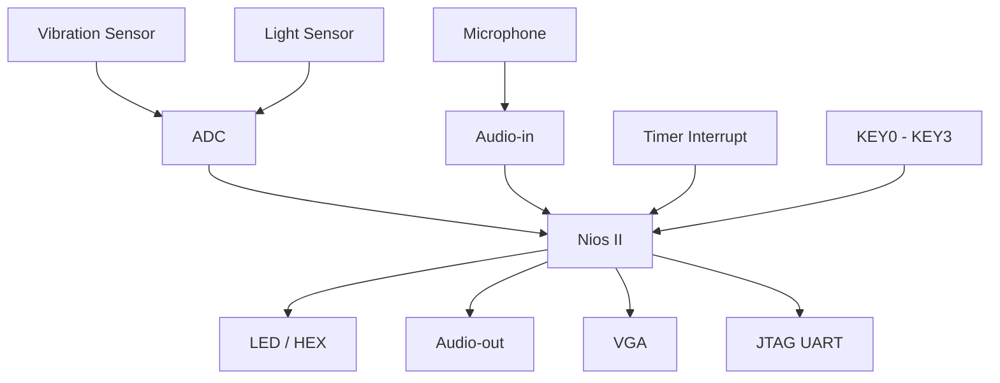

### 4.2 Overall Software Data Flow

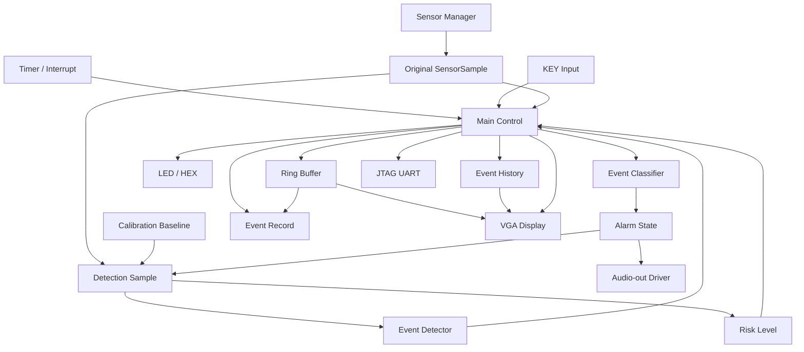

### 4.3 Sample Processing Order

1. Timer Interrupt로 센서 측정 시점을 관리한다.
2. ADC 및 Audio-in을 통해 센서 데이터를 수집한다.
3. 센서 데이터 처리 및 타임스탬프를 부여한다.
4. 초기 상태에 따라 Calibration 또는 Monitoring을 처리한다.
5. Monitoring 상태에서는 이벤트 감지용 샘플을 생성한다.
6. 이벤트 감지 및 위험 단계를 계산한다.
7. 이벤트 발생 시 History 및 Record를 처리한다.
8. LED/HEX 및 Alarm 상태를 제어한다.
9. 현재 원본 센서 샘플을 Event Record에 처리한다.
10. Ring Buffer에 현재 원본 센서 샘플을 저장한다.
11. UART 및 VGA를 갱신한다.
12. KEY 요청 및 주변장치 상태를 메인 루프에서 계속 처리한다.

이벤트 발생 샘플을 Ring Buffer에 추가하기 전에 Event Record를 시작함으로써 Pre-event와 Post-event에 같은 샘플이 중복 저장되는 것을 방지한다.

---

## 5. Implementation Notes

- 각 모듈은 `.c`와 `.h` 파일로 분리한다.
- 공통 하드웨어 주소는 hardware.h에서 관리하는 것을 원칙으로 한다.
- 센서 측정 주기와 이벤트 임계값은 system_config.h에서 관리한다.
- VGA 및 UART 전용 설정값은 해당 구현 파일에서 관리할 수 있다.
- 모듈 간 공통 데이터 구조체를 먼저 정의한다.
- 모듈 간 데이터 전달은 공개 API를 이용한다.
- 다른 모듈의 내부 변수 및 static 함수에 직접 접근하지 않는다.
- ISR은 필요한 최소 작업만 수행한다.
- Audio CODEC 및 공통 Peripheral의 중복 초기화를 방지한다.
- 원본 센서 데이터와 이벤트 감지용 샘플을 구분한다.
- Event History와 Event Record는 서로 다른 저장 구조로 관리한다.
- VGA는 저장된 데이터를 조회하며 이벤트 저장 상태를 변경하지 않는다.
- 개발 진행에 따른 구조 변경은 관련 헤더 및 문서와 함께 관리한다.

### 5.1 Build Integration

VGA 구현 파일:

```makefile
src/display/vga.c
```

Makefile의 SRCS 목록에 포함해야 한다.

기존 VGA 함수 undefined reference 오류는 Makefile 소스 목록에 VGA 구현 파일을 추가하여 해결한 것으로 개발일지에 기록되어 있다.

Intel FPGA Monitor Program에서 프로젝트 또는 Makefile을 다시 생성할 경우 VGA 소스 포함 여부를 확인한다.

---

## 6. System Design Diagram

### 6.1 Event Processing

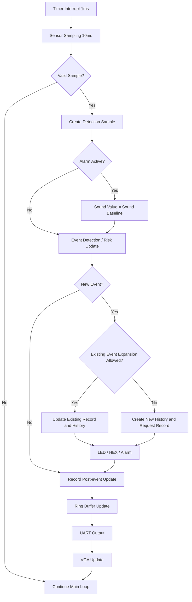

위 흐름도는 기존 이벤트 처리 설계도를 현재 감지용 샘플 분리 및 복합 이벤트 확장 정책에 맞게 확장한 것이다.

---

## 7. System Configuration

### 7.1 Timing

| 항목 | 설정값 |
|---|---:|
| Timer Interrupt | 1ms |
| Sensor Sampling | 10ms |
| Calibration Minimum Time | 1000ms |
| 실제 Calibration | 약 5초 |
| Event Cooldown | 1000ms |
| Event Combine Window | 500ms |
| Event Confirmation | 2 samples |
| KEY Debounce | 50ms |
| LED Blink Interval | 250ms |
| READY Blink Interval | 150ms |
| READY Blink Count | 3 |
| VGA Refresh | 1000ms |
| UART Sensor Output | 1000ms |
| UART History Output | 10000ms |

실제 Calibration 시간 및 기록 시간은 센서 샘플 확보 조건과 샘플링 간격에 영향을 받는다.

### 7.2 Storage Capacity

| Storage | Capacity |
|---|---:|
| Ring Buffer | 500 samples |
| Pre-event | 500 samples |
| Post-event | 500 samples |
| Event Record | 1000 samples |
| Record Count | 1 |
| Event History | 10 events |

### 7.3 Event Threshold

| Event | Detection | Reset |
|---|---:|---|
| SHOCK | 800 | 감지 임계값 미만 |
| SOUND | 1800 | 해제 임계값 400, 유지시간 300ms |
| LIGHT | 150 | 해제 임계값 75, 유지시간 300ms |

SOUND 및 LIGHT는 감지 조건과 래치 해제 조건을 별도로 관리한다.

---

## 8. System Startup

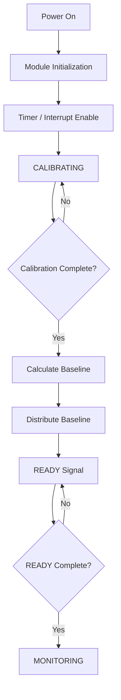

### 8.1 Initialization

main.c에서 각 센서, 저장, 이벤트 및 사용자 인터페이스 모듈을 초기화한다.

Timer 및 Interrupt 설정 이후 메인 루프를 실행한다.

VGA의 기본 화면은 SENSOR MONITOR이다.

### 8.2 Calibration

초기 정상 환경의 진동, 조도 및 소음값을 측정한다.

센서별 측정값을 누적하여 평균값을 계산한다.

현재 Calibration 종료 조건:

- BASELINE_CALIBRATION_MS 이상 경과
- Ring Buffer에 500개 샘플 확보

최소 시간 설정은 1000ms이며 정상적인 샘플링 기준 실제 보정 시간은 약 5초이다.

### 8.3 Baseline Distribution

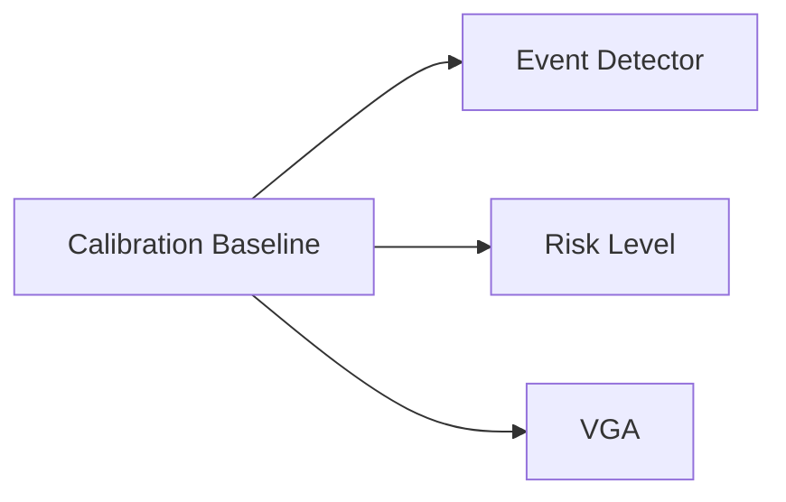

Event Detector 및 Risk Level은 초기 평균값을 판단 기준으로 사용한다.

VGA는 LIMIT 표시와 DELTA 계산에 사용한다.

### 8.4 READY Signal

Calibration 완료 후 LED READY 표시를 수행한다.

- 점멸 간격: 150ms
- 점멸 횟수: 3회

READY 표시 완료 이후 정상 Monitoring 상태로 전환한다.

기존 초기 Audio-out 테스트 호출의 종료 방식은 추가 검증한다.

### 8.5 Record State and Startup State

시작 상태와 Record 상태를 구분한다.

| 구분 | 상태 |
|---|---|
| Startup | CALIBRATING / READY / MONITORING |
| Record | 기록 전 / 수집 중 / 저장 완료 |
| VGA | REALTIME / HISTORY |
| Risk | NORMAL / CAUTION / DANGER |

기존 SystemState 모듈의 MONITORING, RECORDING, SAVED 설계는 API Contract에 보존한다.

현재 main.c의 시작 상태 및 Record 관리 방식과 기존 상태 전환 계약의 차이는 추가 검토한다.

---

## 9. Main Loop Architecture

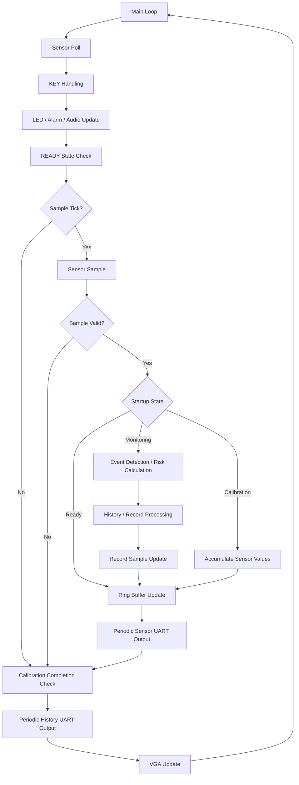

위 설계도는 주요 처리 관계를 설명한다.

실제 로그 출력 및 상태 확인의 상세 위치는 main.c 구현을 따른다.

센서 측정, UART 및 VGA는 서로 다른 주기를 사용하지만 동일한 메인 루프에서 처리한다.

따라서 UART FIFO 대기 및 VGA 전체 화면 출력에 따른 실제 샘플링 지연을 검증해야 한다.

---

## 10. Event Detection Architecture

### 10.1 Baseline-based Detection

    Difference = abs(Current Value - Baseline)

센서별 변화량을 감지 임계값과 비교한다.

한 번의 측정값만으로 이벤트를 확정하지 않고 연속 2회 감지 조건을 적용한다.

### 10.2 Latch and Cooldown

래치는 동일한 이상 상태가 지속되는 동안 같은 이벤트가 반복 발생하는 것을 방지한다.

쿨다운은 센서별 마지막 이벤트 발생 시각을 기준으로 1000ms를 적용한다.

### 10.3 SHOCK Detection

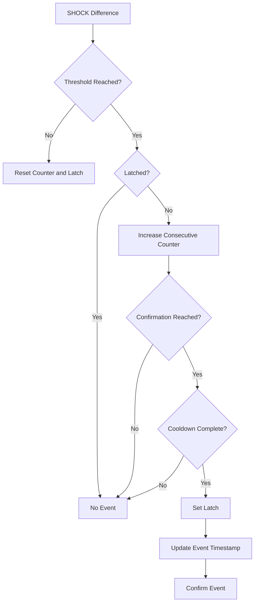

쿨다운 확인 전에 래치를 설정하지 않는다.

쿨다운 종료 이후까지 이상 상태가 지속되는 경우 새로운 이벤트로 확정할 수 있도록 한다.

### 10.4 SOUND and LIGHT Reset

SOUND:

- 감지 기준 1800
- 래치 해제 기준 400
- 해제 유지시간 300ms

LIGHT:

- 감지 기준 150
- 래치 해제 기준 75
- 해제 유지시간 300ms

별도의 래치 해제 조건을 사용하여 감지와 정상 복귀 조건을 구분한다.

---

## 11. Alarm Feedback Prevention

경고음이 마이크에 다시 입력되면 SOUND 이벤트로 재감지될 가능성이 있다.

현재 main.c는 원본 센서 샘플을 복사하여 감지용 샘플을 생성한다.

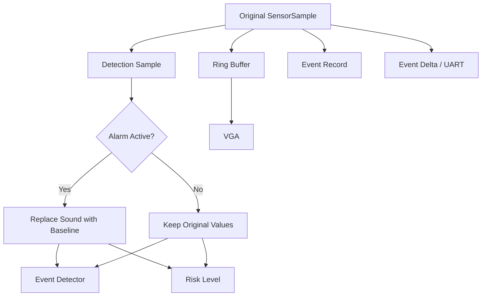

경고음 활성 중에는 감지용 소음값만 초기 평균값으로 대체한다.

원본 진동, 조도 및 소음 측정값은 유지한다.

### Limitations

- 경고음 활성 중 실제 외부 소음 감지도 제한된다.
- 경고음 종료 직후 잔류 소음은 별도로 차단하지 않는다.
- 감지용 소음값 대체가 SOUND 래치 해제에 영향을 줄 수 있다.
- VGA의 원본 SOUND 측정값과 감지용 RiskLevel이 서로 다른 상태를 나타낼 수 있다.

---

## 12. Multiple Event Architecture

### 12.1 Multiple Event Detection

새로운 센서 이벤트가 확정되면 다른 센서의 래치 상태와 현재 변화량을 확인한다.

복합 이벤트는 이벤트 비트 플래그를 이용하여 표현한다.

| Event Combination | Flags |
|---|---:|
| SHOCK + SOUND | 3 |
| SHOCK + LIGHT | 5 |
| SOUND + LIGHT | 6 |
| SHOCK + SOUND + LIGHT | 7 |

Event Classifier에서는 복합 이벤트를 표시 코드 4로 변환한다.

### 12.2 Multiple Event Expansion

기존 이벤트 확장과 새로운 독립 이벤트 생성은 main.c에서 구분한다.

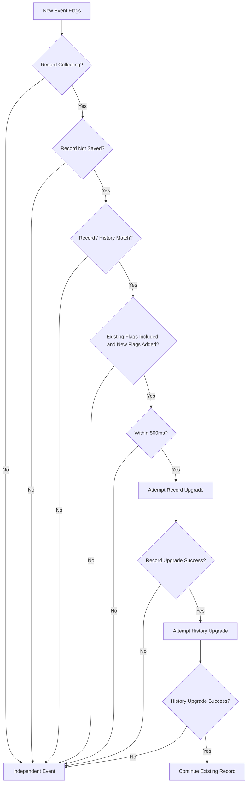

복합 확장 성공 시:

- 기존 Record 데이터 유지
- 이벤트 발생 시각 유지
- Record 및 History 플래그 갱신
- History DELTA 갱신
- History 개수 유지

500ms 조건은 독립적인 이벤트의 잘못된 결합 가능성을 줄이기 위한 시간 기반 정책이다.

물리적인 이벤트 연속성을 완전히 보장하지 않는다.

Record와 History 갱신 중 한쪽만 성공한 경우의 일관성 유지도 통합 테스트에서 확인한다.

---

## 13. Data Storage Architecture

### 13.1 Ring Buffer

최신 센서 샘플 최대 500개를 유지한다.

```text
Oldest                            Newest
   |                                 |
   v                                 v

[ S0 ][ S1 ][ S2 ] ... [ S498 ][ S499 ]
```

10ms 샘플링 기준 약 5초의 센서 데이터를 보존한다.

용량을 초과하면 가장 오래된 데이터를 덮어쓴다.

### 13.2 Event Record

```text
               Event Trigger
                     |
                     v

+--------------------+--------------------+
|     Pre-event      |     Post-event     |
|    500 samples     |    500 samples     |
|     about 5s       |     about 5s       |
+--------------------+--------------------+

              Up to 1000 samples
```

Pre-event 데이터는 이벤트 발생 이전 Ring Buffer 데이터에서 확보한다.

Post-event 데이터에는 이벤트 발생 샘플이 첫 번째 데이터로 포함된다.

정상적인 10ms 간격에서 이후 500개 샘플의 시각은 이벤트 발생 시점부터 4990ms까지이다.

### 13.3 Record Policy

| 상태 | 기존 설계 | 현재 구현 방향 |
|---|---|---|
| 기록 전 | 새 기록 시작 | 새 기록 시작 |
| 기록 중 | 기존 기록 보호 | 독립 이벤트 발생 시 새 기록 요청 |
| 기록 완료 | 기존 기록 유지 | 독립 이벤트 발생 시 새 기록 요청 |
| 복합 확장 | 기존 기록 유지 | 기존 기록 유지 및 Flags 갱신 |
| KEY1 | 기록 초기화 | 기록 유지 |

기존 Record 보호 정책과 현재 구현의 차이는 아직 해결되지 않았다.

Record 저장 개수는 최대 1개를 유지한다.

### 13.4 Event History

최근 이벤트 최대 10개를 저장한다.

저장 항목:

- timestamp_ms
- event_flags
- delta

최신 이벤트부터 조회할 수 있다.

```text
Index 0 : Newest Event
Index 1 : Previous Event
...
Index 9 : Oldest Stored Event
```

용량을 초과하면 가장 오래된 이벤트를 교체한다.

### 13.5 Storage Comparison

| 항목 | Ring Buffer | Event Record | Event History |
|---|---|---|---|
| 목적 | 최신 센서값 | 이벤트 전후 기록 | 이벤트 요약 |
| 저장 단위 | SensorSample | SensorSample | EventHistoryEntry |
| 최대 용량 | 500 | 1000 | 10 |
| VGA | 최신 샘플 조회 | 직접 조회하지 않음 | 이벤트 목록 조회 |
| UART | 센서값 출력 | 대표 샘플 출력 | 이벤트 목록 출력 |

Event History에 이벤트가 저장되었다고 해서 Event Record 수집이 완료된 것은 아니다.

---

## 14. KEY Input Architecture

KEY0부터 KEY3까지 사용한다.

인터럽트 마스크는 0xFU이다.

각 KEY에 독립적인 50ms 디바운싱을 적용한다.

| KEY | Function |
|---|---|
| KEY0 | 경고음 중지 |
| KEY1 | 경고음 중지, LED OFF, HEX 00 |
| KEY2 | SENSOR MONITOR |
| KEY3 | LAST EVENT |

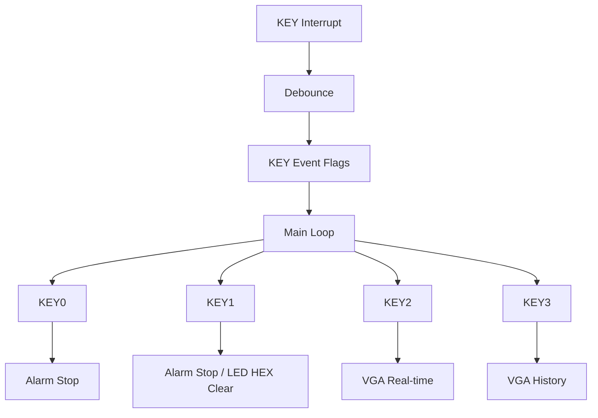

KEY0 및 KEY1은 저장된 센서 및 이벤트 데이터를 삭제하지 않는다.

KEY2 및 KEY3은 VGA 조회 화면을 변경한다.

현재 선택된 화면의 KEY를 다시 입력하면 데이터 새로고침을 요청한다.

---

## 15. LED / HEX and Alarm Architecture

### 15.1 Display Classification

| Event | HEX Code | LED |
|---|---:|---|
| NONE | 0 | OFF |
| SHOCK | 1 | LED0 |
| SOUND | 2 | LED1 |
| LIGHT | 3 | LED2 |
| MULTIPLE | 4 | 해당 센서 LED 조합 |

LED 및 HEX는 이벤트 플래그에 대응하는 정보를 표시한다.

### 15.2 Alarm Data Flow

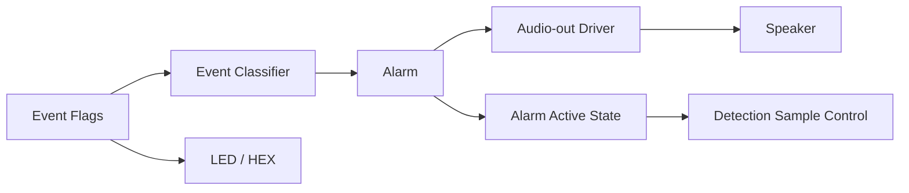

### 15.3 Alarm Configuration

| 항목 | 설정값 |
|---|---:|
| 기본 경고음 주파수 | 800Hz |
| 기본 출력시간 설정 | 200ms |
| 복합 주파수 1 | 600Hz |
| 복합 주파수 2 | 1200Hz |
| 복합 간격 설정 | 100ms |
| 복합 출력시간 설정 | 400ms |

기존 이벤트별 경고 패턴은 API Contract에 유지한다.

실제 반복 횟수 및 자동 종료 동작은 최신 코드 및 보드에서 확인한다.

---

## 16. VGA Architecture

### 16.1 VGA Buffer Structure

| 항목 | Pixel Buffer | Character Buffer |
|---|---|---|
| Base Address | 0x08000000 | 0x09000000 |
| Resolution | 320 x 240 | 80 x 60 |
| Format | RGB565 | ASCII |
| Row Stride | 1024 bytes | 128 bytes |

픽셀 버퍼는 배경, 구분선 및 색상 문자열 출력에 사용한다.

문자 버퍼는 일반 문자열, 센서 측정값 및 이벤트 정보 출력에 사용한다.

### 16.2 Data Flow

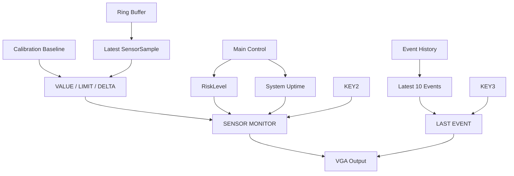

VGA는 센서를 직접 측정하지 않는다.

VGA는 이벤트 기록을 직접 저장하거나 변경하지 않는다.

### 16.3 Screen 1: SENSOR MONITOR

```text
+------------------------------------------------------+
| SENSOR MONITOR                                 LIVE  |
|                                                      |
| UPTIME: 15 s                                         |
|------------------------------------------------------|
| SENSOR          VALUE       LIMIT        DELTA       |
|                                                      |
| VIBRATION       1200        1220         -20         |
|                                                      |
| SOUND            550         500         +50         |
|                                                      |
| LIGHT           2500        2500          +0         |
|------------------------------------------------------|
| RISK: NORMAL                                         |
| THRESHOLD: V800 S1800 L150                            |
| DELTA=VALUE-LIMIT                                    |
+------------------------------------------------------+
```

위 데이터는 화면 설명용 예시이다.

| 항목 | 데이터 출처 |
|---|---|
| VALUE | Ring Buffer 최신 원본 센서값 |
| LIMIT | 초기 Calibration 평균값 |
| DELTA | VALUE - LIMIT |
| RISK | main.c의 현재 RiskLevel |
| UPTIME | 현재 시스템 시간 |
| THRESHOLD | 센서별 이벤트 감지 임계값 |

실시간 DELTA는 증가 및 감소 방향을 유지한다.

위험 단계 색상:

- NORMAL: 녹색
- CAUTION: 노란색
- DANGER: 빨간색

### 16.4 Calibration Display

유효한 센서 샘플은 존재하지만 초기 기준값이 설정되지 않은 경우 LIMIT은 CAL..., DELTA는 ---로 표시한다.

위험 단계 영역에는 CALIBRATING을 표시한다.

### 16.5 No Sample Handling

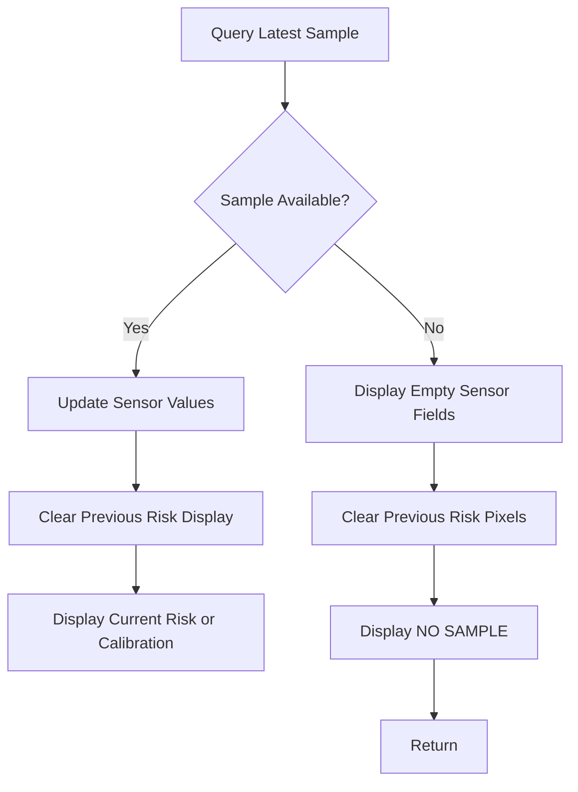

이전 위험 단계의 색상 글자는 픽셀 버퍼에 존재하므로 NO SAMPLE 출력 전에 별도로 초기화한다.

최신 샘플 조회 실패와 개별 센서 입력 오류는 서로 다른 상태이다.

### 16.6 Screen 2: LAST EVENT

```text
+------------------------------------------------------+
| LAST EVENT                                  HISTORY  |
|------------------------------------------------------|
| NO.      TIME          TYPE              DELTA       |
|                                                      |
|  1       18.300 s      LIGHT              420        |
|  2       15.200 s      MULTIPLE          2300        |
|  3       12.100 s      SHOCK             1250        |
|  4       ---           ---               ---        |
|  5       ---           ---               ---        |
|  6       ---           ---               ---        |
|  7       ---           ---               ---        |
|  8       ---           ---               ---        |
|  9       ---           ---               ---        |
| 10       ---           ---               ---        |
|                                                      |
| Newest first / Stores up to 10 events                 |
| STORED: 3 / 10                                       |
+------------------------------------------------------+
```

위 이벤트 데이터는 화면 설명용 예시이다.

History DELTA는 저장된 절댓값 변화량을 사용한다.

단일 이벤트는 SHOCK, SOUND, LIGHT로 표시하고 복합 이벤트는 MULTIPLE로 표시한다.

HISTORY는 현재 화면의 종류를 의미한다.

Record 수집 완료 상태와 구분한다.

### 16.7 Colored Text

색상 문자열은 5x7 글꼴을 2배 확대하여 출력한다.

HISTORY 출력에 필요한 H 및 Y 글꼴을 포함한다.

글자 수 증가에 따라 오른쪽 상단의 시작 좌표를 조정한다.

### 16.8 Screen Transition

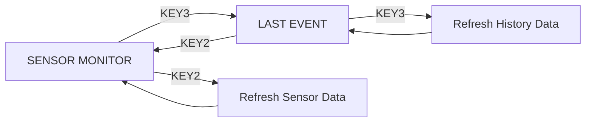

다른 화면으로 전환하면 이전 픽셀 및 문자 버퍼를 초기화한다.

같은 화면을 선택하면 데이터 새로고침을 요청한다.

### 16.9 Refresh Policy

일반적인 VGA 데이터 갱신 주기는 1000ms이다.

다음 조건에서 전체 화면 재출력을 수행한다.

- 초기 화면 출력
- 화면 전환
- 초기 센서 평균값 설정

일반 데이터 갱신 시에는 센서값, 위험 단계, History 목록 등 변경되는 영역을 갱신한다.

VGA의 실제 갱신 시간 및 센서 샘플링 지연은 보드에서 확인한다.

---

## 17. UART Architecture

JTAG UART는 개발 및 시스템 상태 확인에 사용한다.

| 출력 | 시점 |
|---|---|
| INIT | 초기화 |
| CAL | 초기 평균값 설정 |
| READY | 준비 완료 |
| Sensor Sample | 1초마다 |
| EVENT | 새로운 이벤트 발생 |
| HISTORY Saved | History 저장 |
| HISTORY Updated | 복합 이벤트 확장 |
| RECORD BEFORE | Record 수집 시작 |
| RECORD AFTER | Post-event 대표 샘플 |
| RECORD SAVED | Record 수집 완료 |
| EVENT HISTORY | 10초마다 |
| KEY | 주요 사용자 입력 처리 |

Record 대표 샘플은 100개 간격으로 출력한다.

UART 출력 개수와 실제 저장 데이터 개수는 구분한다.

UART History는 오래된 이벤트부터 출력하고 VGA History는 최신 이벤트부터 출력한다.

기존 보드 테스트에서 일부 UART 문자열 누락이 관찰되었다.

FIFO 대기 및 타임아웃 처리에 의한 출력 누락 및 샘플링 지연 가능성을 검토한다.

---

## 18. Team Responsibility

### 이윤아

- Sensor
- Timer
- Interrupt
- Ring Buffer
- Event Record

### 임연경

- Event Detection
- Event Classification
- Risk Level
- LED / HEX
- Alarm
- KEY
- System State
- VGA

### 공동

- 공통 자료구조
- 공통 설정값
- API 규약
- Main Integration
- Event History 연동
- 복합 이벤트 확장 정책
- 통합 테스트
- 프로젝트 문서 정리

기존 API Contract에 정의된 담당 범위를 유지한다.

추가 모듈의 상세 분담은 팀원 간 합의에 따른다.

---

## 19. Current Limitations

| 항목 | 검토 내용 |
|---|---|
| Event Record | 수집 중 기존 기록 보호 및 교체 정책 |
| System State | 기존 상태 관리 계약과 현재 main.c 방식의 차이 |
| Sensor API | 기존 Sensor API와 Sensor Manager API의 호환 관계 |
| Audio-in | 조회 실패 데이터의 유효성 처리 |
| UART | 문자열 누락 및 FIFO 대기 |
| Sampling | 실제 10ms 샘플링 간격 |
| Calibration | 설정 시간과 실제 동작 시간의 정합성 |
| Moving Average | 센서별 필터 적용 여부 |
| VGA | 전체 화면 출력으로 인한 샘플링 지연 |
| Alarm | 경고음 활성 중 외부 소음 감지 제한 |
| Alarm Recovery | 경고음 종료 이후 소음 감지 복귀 |
| Risk Level | 세부 위험 단계 판정 기준 |
| User Settings | SW 및 실행 중 설정 기능의 구현 범위 |

현재 Calibration 및 VGA 화면 갱신의 추가 최적화는 보류한다.

기존 센서 측정 및 저장 기능은 유지한다.

---

## 20. Verification

본 문서는 기존 architecture.md의 구조와 개발 원칙을 보존하면서 현재 확인된 모듈 연동 및 코드 변경 사항을 반영하였다.

기존 설계와 현재 구현이 다른 부분은 별도 검토 사항으로 구분하였다.

최신 수정 코드에 대한 Clean Build 및 실제 DE1-SoC 보드 테스트가 필요하다.

다음 기능을 통합 검증한다.

- 센서 측정 및 초기 평균값
- 이벤트 감지 및 재감지
- 복합 이벤트 분류 및 확장
- 위험 단계 계산
- Event Record 및 Event History
- LED / HEX / Alarm
- KEY0~KEY3
- VGA 실시간 및 History 화면
- UART 출력
- 저장 데이터 보존
- 실제 센서 샘플링 시간 간격

**Status:** Revised Design — Documentation Comparison Completed / Hardware Verification Pending
